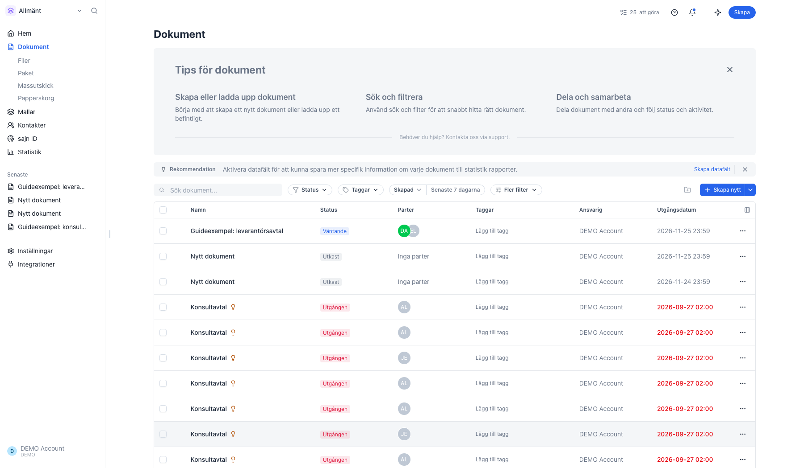
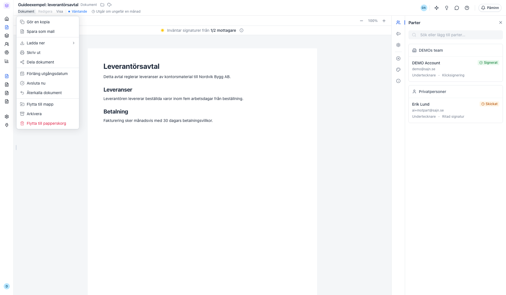
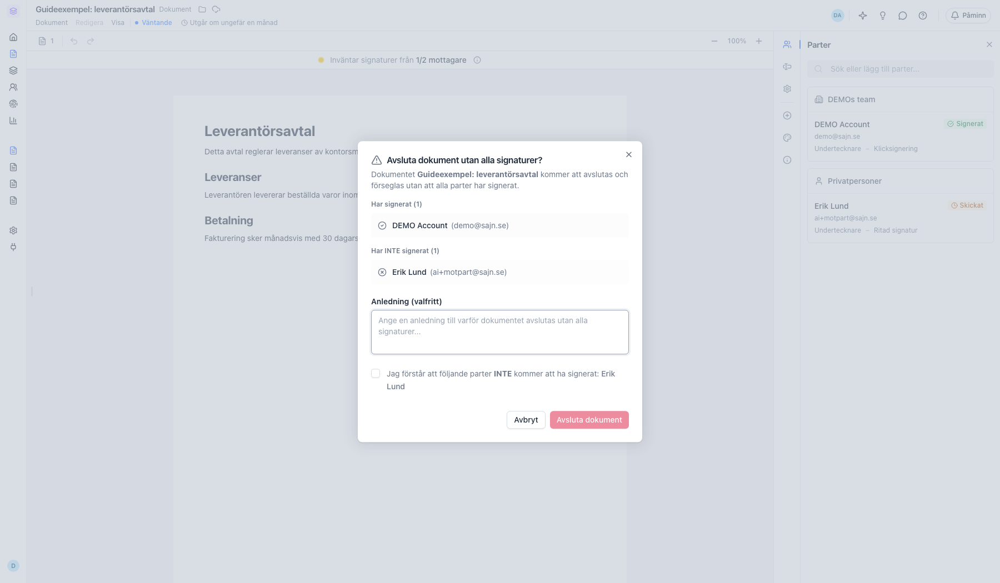
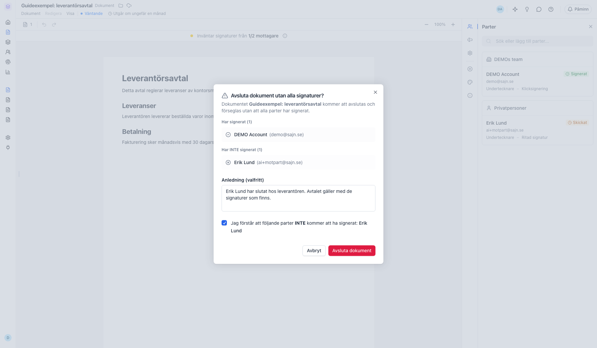
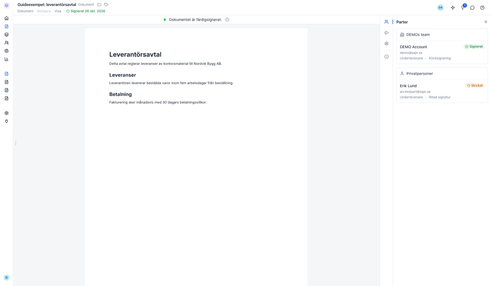

# Avsluta ett dokument innan alla har signerat

<!--
slug: avsluta-dokument-i-fortid
audience: Alla användare
last_verified: 2026-10-26
auto-generated from steps.json — edit the spec, then re-run the runner
-->

Har några av parterna signerat men inte alla, och de som saknas kommer inte att signera? Då kan du avsluta dokumentet med de signaturer som finns. Dokumentet förseglas och blir slutgiltigt.

Stegen före den första bilden skapar exempeldokumentet: ett avtal med två parter där den ena har signerat. De stegen har inga bilder.

## Innan du börjar

- Dokumentet har status Väntande eller Utgången.
- Minst en part har signerat, men inte alla.
- Din roll i arbetsytan har behörigheten Tvinga slutförande av dokument.

## Steg

### 1. Hitta dokumentet som väntar på signering

I Dokument visar raden status Väntande. Här har en av två parter signerat. Klicka på raden för att öppna dokumentet.

### 2. Välj Avsluta nu i menyn Dokument

Menyn Dokument finns längst upp till vänster i dokumentet. Avsluta nu visas bara när minst en part har signerat och minst en part saknas.

### 3. Kontrollera vilka som har signerat

Rutan listar parterna i två grupper: Har signerat och Har INTE signerat. Kontrollera att det stämmer innan du går vidare.

### 4. Skriv en anledning och bekräfta

Anledningen är valfri. Den sparas i dokumentets historik. Markera kryssrutan för att bekräfta att parterna i listan inte kommer att ha signerat. Knappen Avsluta dokument går inte att klicka på förrän du har markerat kryssrutan.

### 5. Dokumentet är färdigsignerat

Dokumentet märks Signerat och förseglas med de signaturer som finns. Parterna som inte signerat får ett mejl om att dokumentet har avslutats utan deras signatur. Schemalagda påminnelser stoppas.

---

*Senast verifierad: 2026-10-26. Generad av `scripts/guide-runner.ts`.*
