# Skicka dokument som paket

<!--
slug: paket
audience: Den som skickar dokument i arbetsytan
last_verified: 2026-11-06
auto-generated from steps.json — edit the spec, then re-run the runner
-->

Ett paket skickar flera dokument med en inbjudan. Varje part signerar alla sina dokument med en underskrift. Varje dokument behåller sin egen signatur, försegling och logg.

## Innan du börjar

- Du får skicka dokument i arbetsytan utan godkännande.
- Paket kräver Team eller högre.

## Steg

### 1. Skapa ett nytt paket

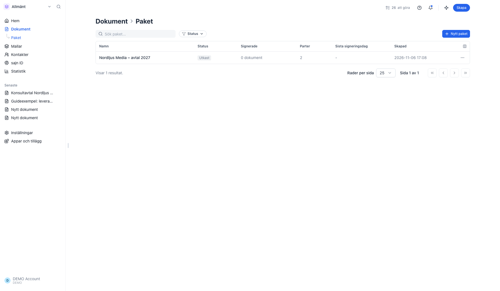

Paket ligger under Dokument i sidomenyn. Klicka på Nytt paket.

### 2. Lägg till dokument

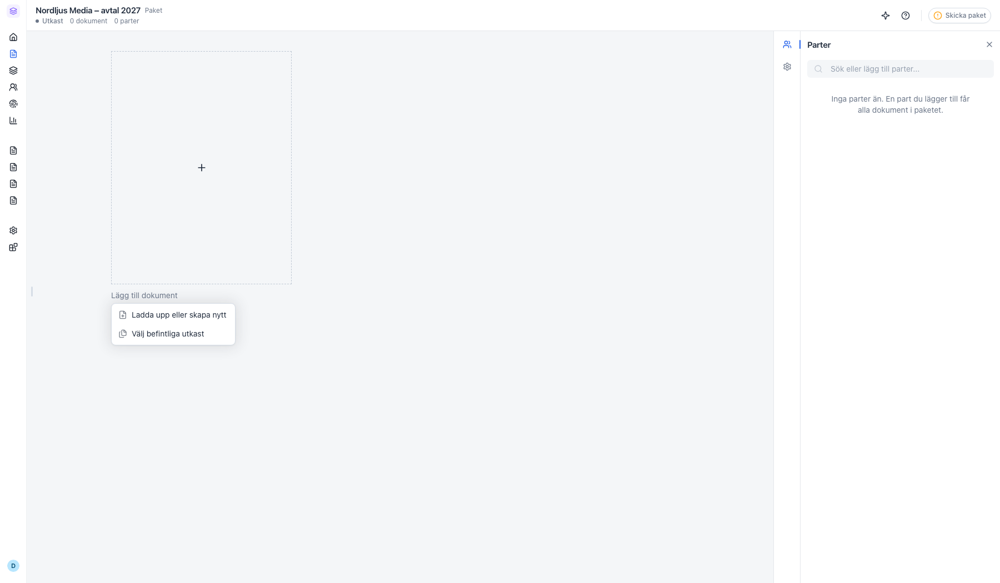

Ladda upp filer, skapa ett dokument från en mall eller välj utkast du redan har.

### 3. Välj befintliga utkast

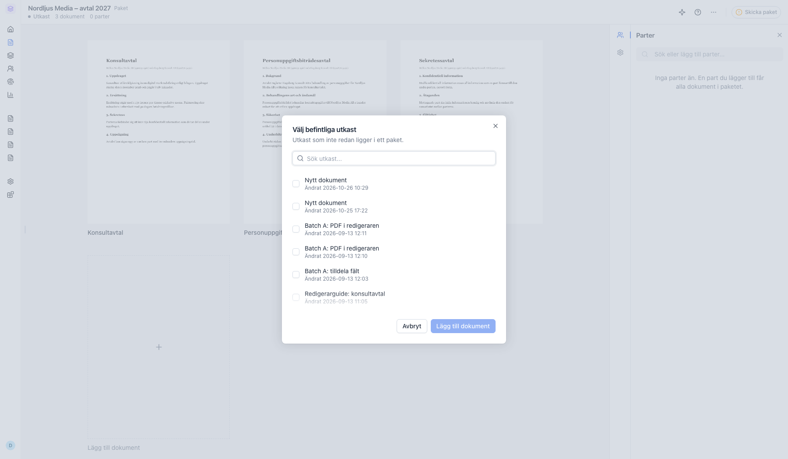

Listan visar utkast som inte redan ligger i ett paket.

### 4. Se vad som saknas

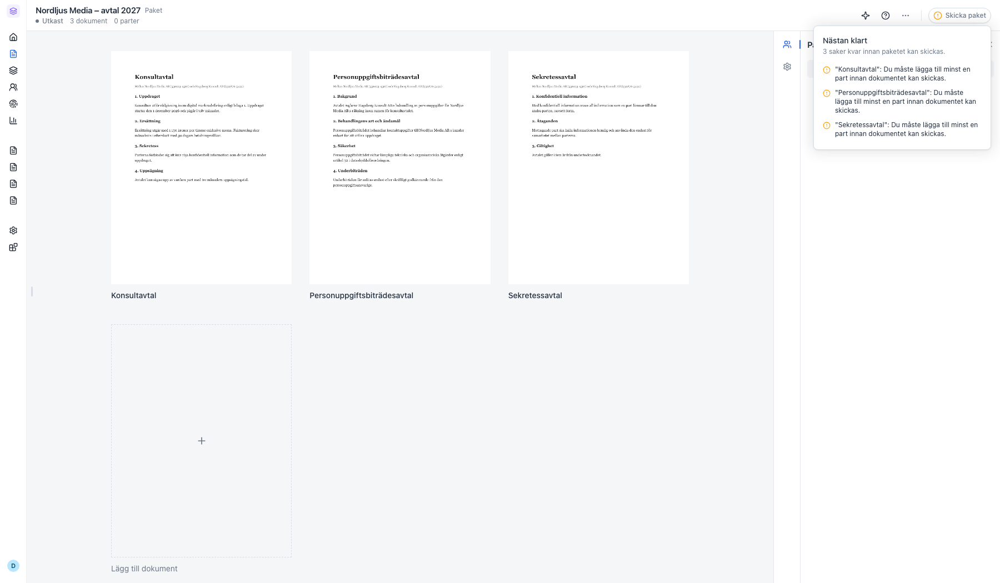

Skicka paket visar vad som saknas innan paketet kan skickas.

### 5. Lägg till parterna

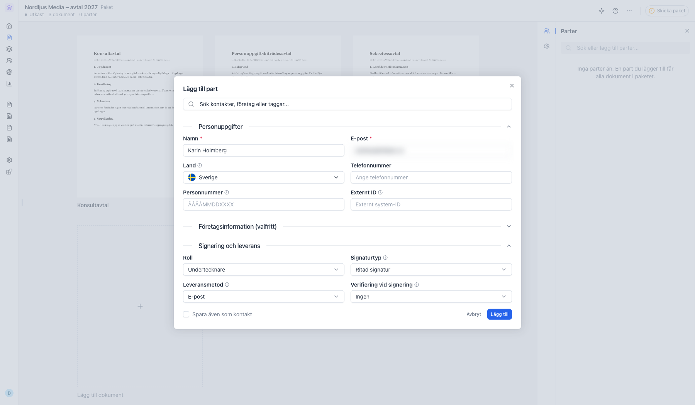

En part du lägger till får alla dokument i paketet.

### 6. Välj vilka dokument varje part signerar

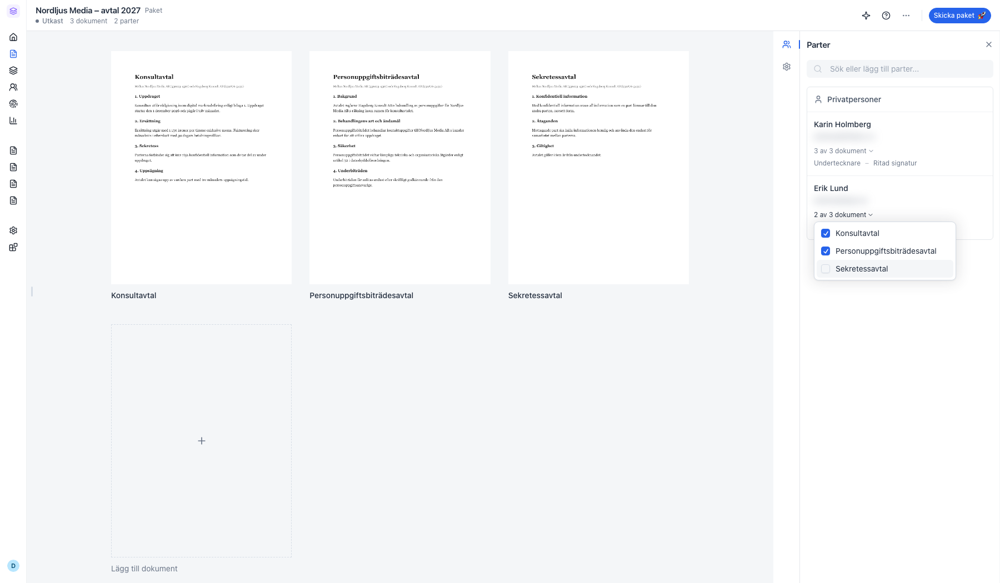

Klicka på antalet dokument under en part och bocka ur dokument som parten inte ska signera.

### 7. Ställ in paketet

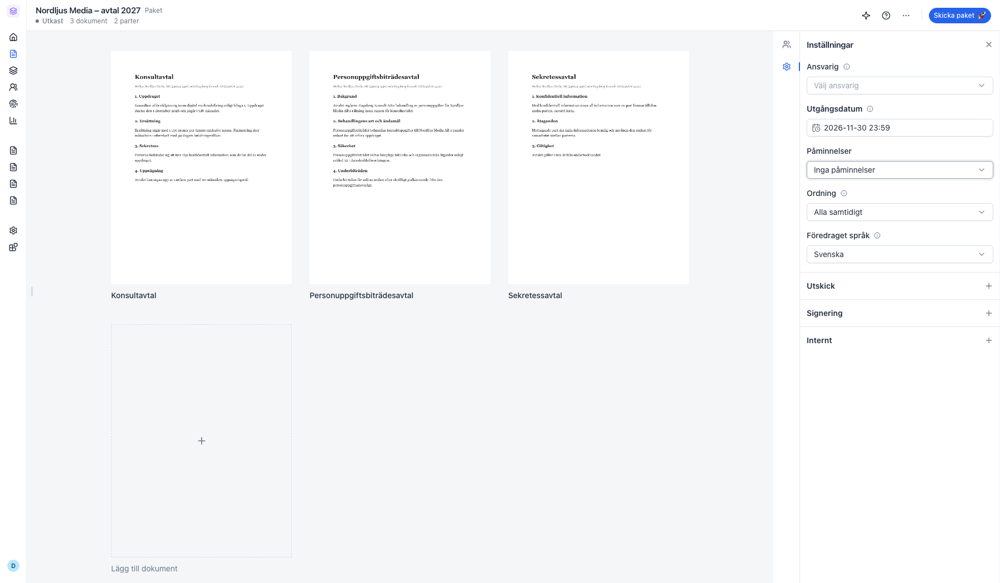

Inställningarna gäller alla dokument i paketet.

### 8. Redigera dokumentens innehåll

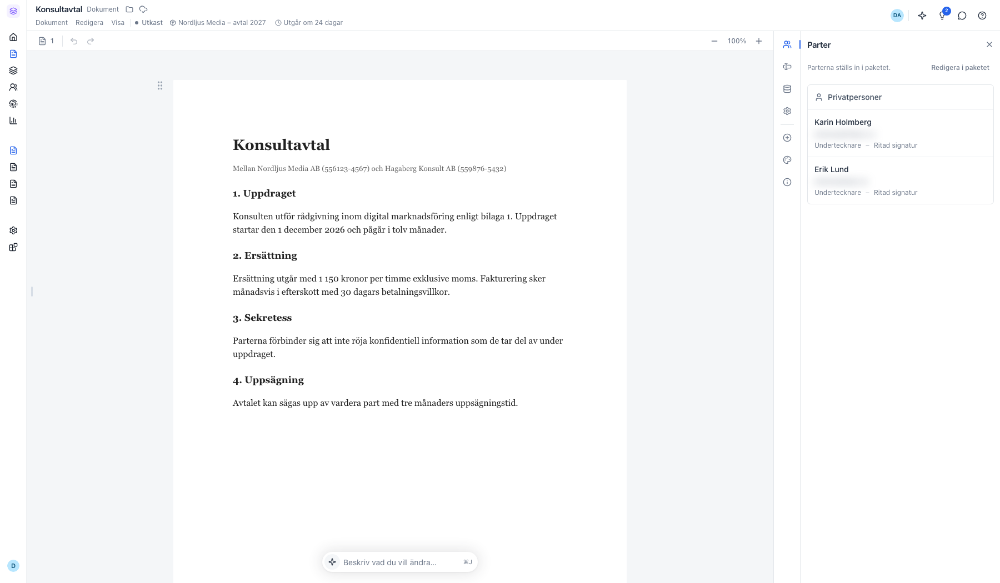

Innehållet redigerar du i dokumentet. Parterna ställs in i paketet.

### 9. Skicka paketet

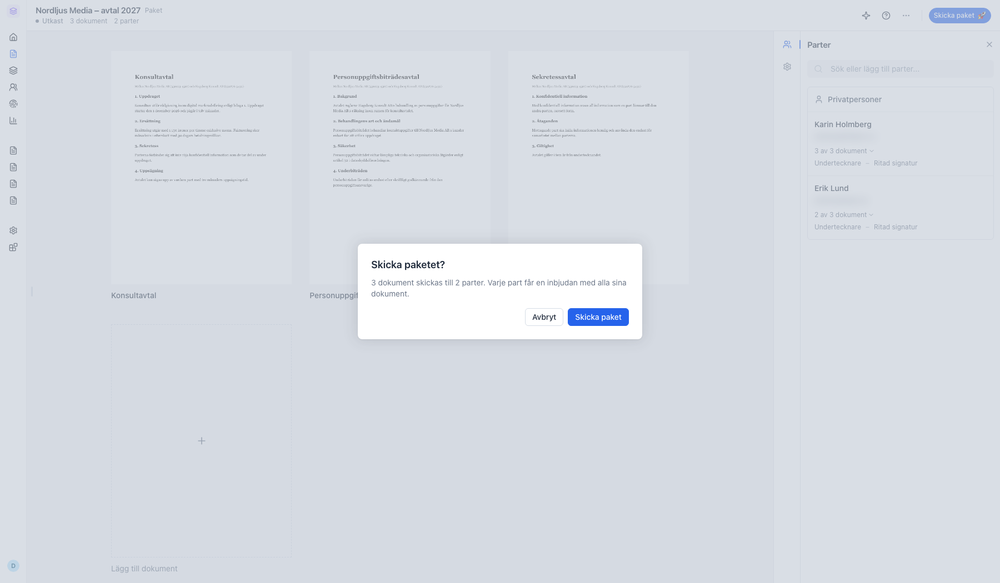

Varje part får en inbjudan med alla sina dokument.

### 10. Följ paketet

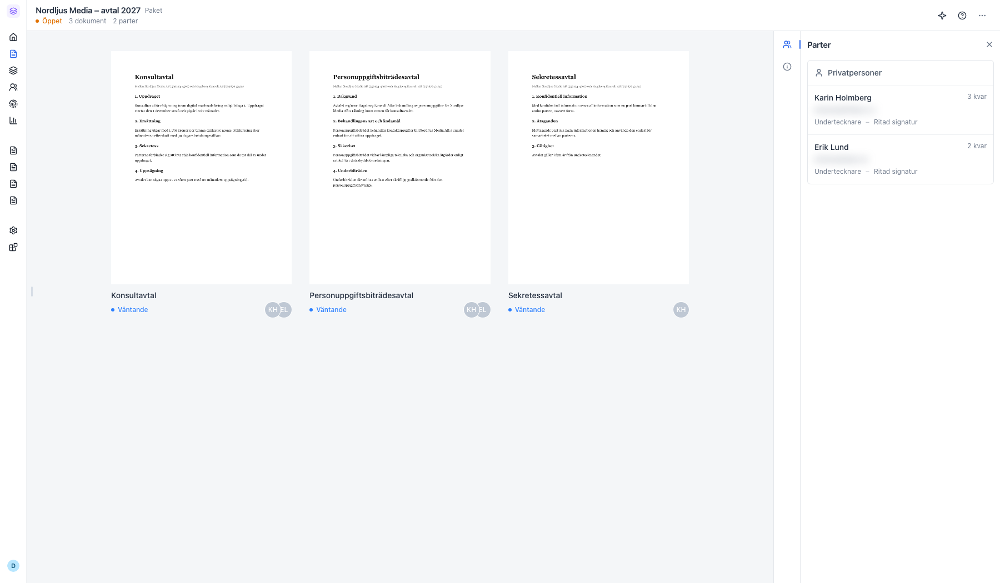

Under Parter står hur många dokument varje part har kvar att signera.

### 11. Hjälp en part som inte har signerat

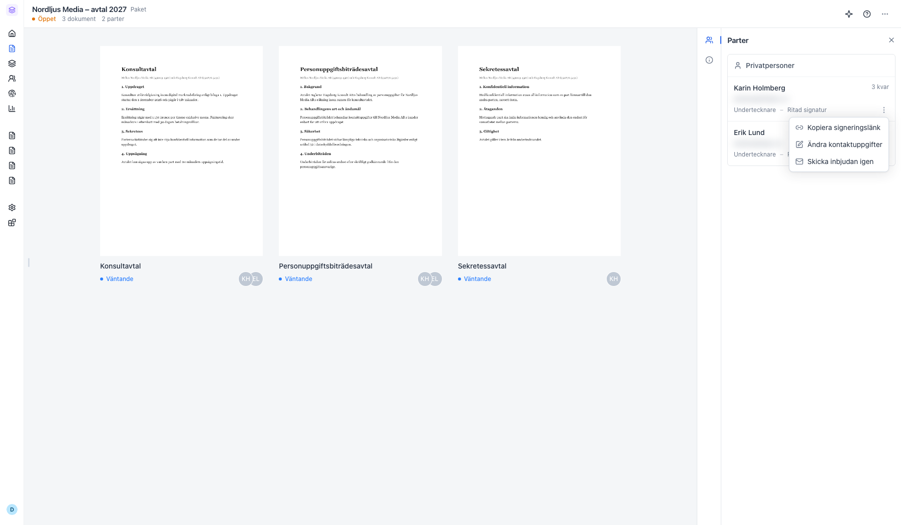

Kopiera signeringslänken, ändra kontaktuppgifterna eller skicka inbjudan igen.

### 12. Ändra kontaktuppgifter

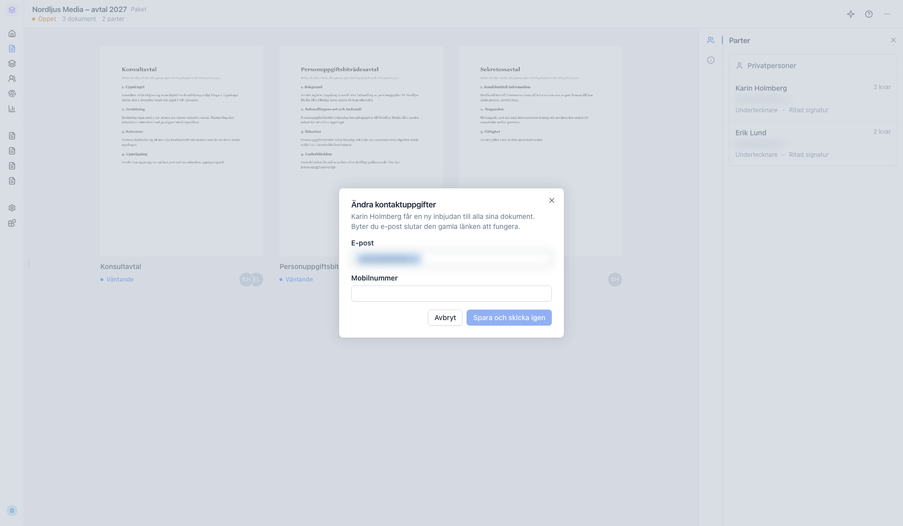

Parten får en ny inbjudan till alla sina dokument.

### 13. Återkalla paketet

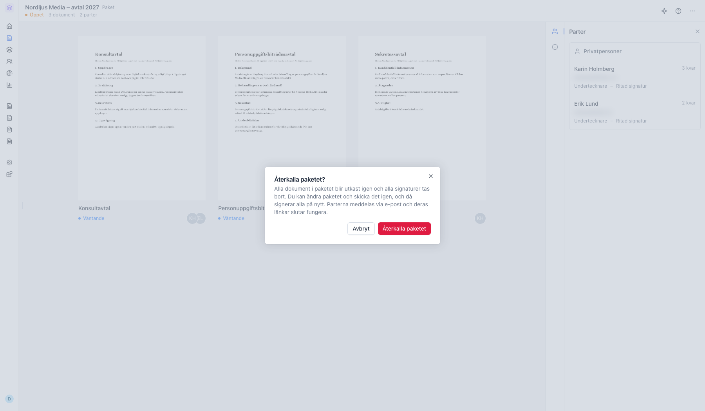

Alla dokument blir utkast igen och alla signaturer tas bort.

### 14. Se alla paket

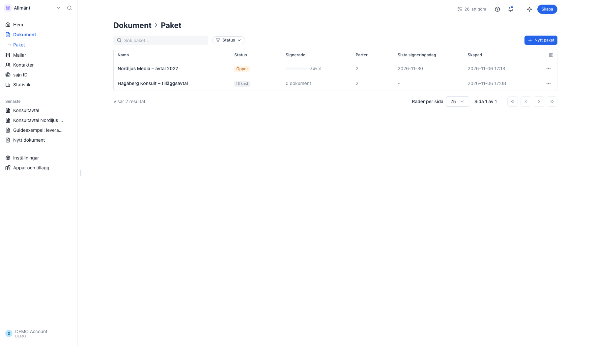

Listan visar status, hur många dokument som är signerade, antal parter och sista signeringsdag.

---

*Senast verifierad: 2026-11-06. Generad av `scripts/guide-runner.ts`.*
