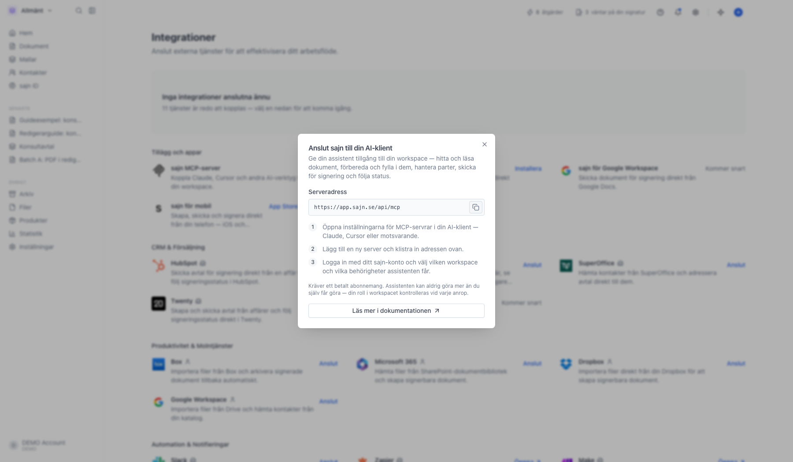
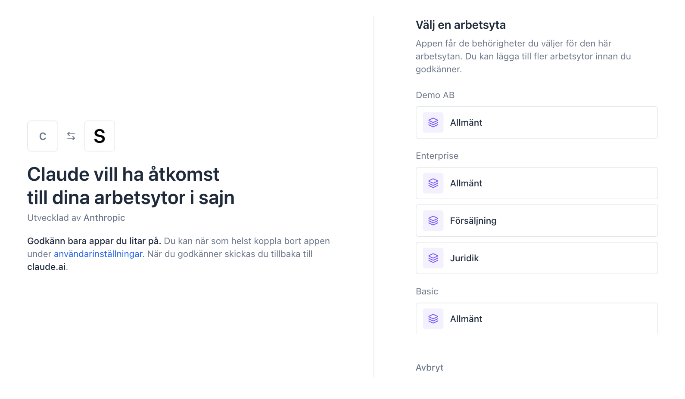
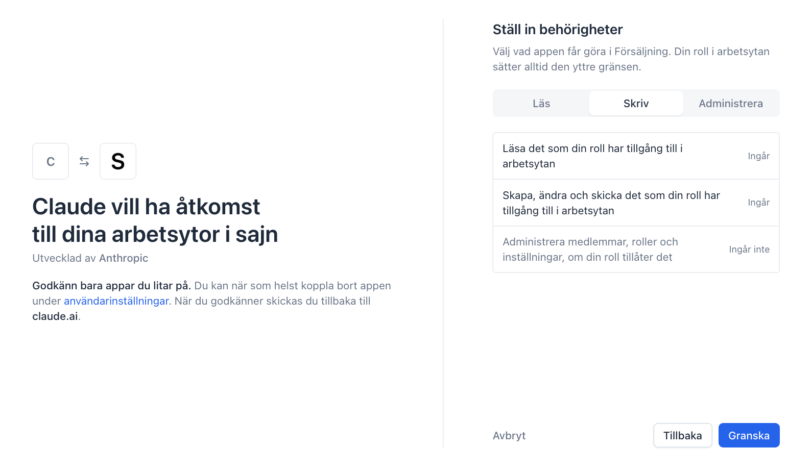
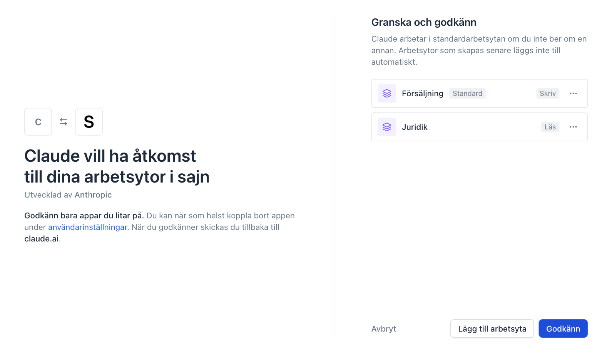
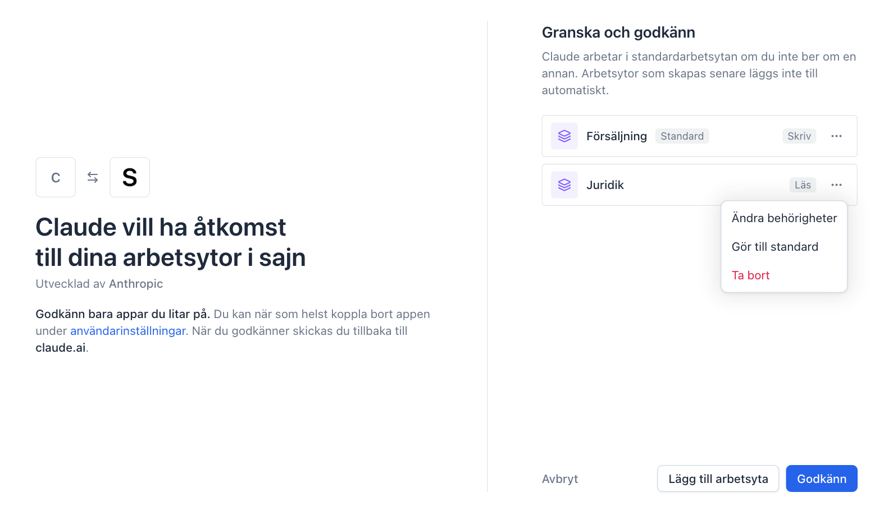
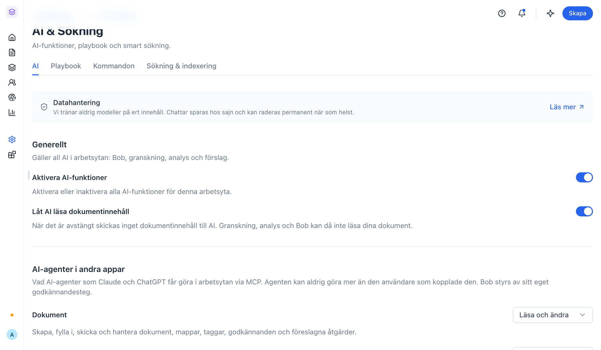

Med sajn kopplat till ChatGPT eller Claude ber du assistenten om saker med vanliga ord, där du redan sitter: "skapa ett NDA från vår mall och lägg till Anna som part", "vilka avtal väntar på underskrift?" eller "påminn alla som inte har signerat". Assistenten arbetar i dina riktiga arbetsytor, med dina behörigheter.

Du väljer själv vilka arbetsytor assistenten får arbeta i och vad den får göra i var och en. Den kan aldrig göra mer än du själv får göra.

## Innan du börjar

- Du har ett sajn-konto och är medlem i arbetsytorna du vill koppla.
- Din roll i varje arbetsyta har behörigheten att ansluta appar. Den ingår i standardrollerna.
- AI är påslaget i arbetsytan. I en arbetsyta där AI är avstängt nekas alla anrop från assistenten.
- Kopplingen fungerar på alla planer.

## Steg för steg

<Steps>
  <Step title="Starta kopplingen från ChatGPT eller Claude">
    **ChatGPT:** öppna [sajn-appen i ChatGPT:s appkatalog](https://chatgpt.com/plugins/plugin_asdk_app_6ae1b3c33a0c8191a474eb9eb3c3485b) och anslut den.

    **Claude:** öppna **Settings** > **Connectors** > **Add custom connector**, skriv *sajn* som namn och klistra in serveradressen `https://app.sajn.se/api/mcp`.

    **Andra AI-klienter**, till exempel Cursor: adressen och stegen finns i sajn under [Integrationer](https://app.sajn.se/~/integrations), raden **sajn MCP-server** under **Tillägg och appar**. Klicka **Anslut** för att kopiera adressen.

    <Frame>
      
    </Frame>
  </Step>

  <Step title="Logga in och välj en arbetsyta">
    Assistenten öppnar sajns inloggning i ett nytt fönster. Logga in, så visas godkännandesidan. Till vänster står vem som ber om åtkomst och vart du skickas tillbaka. Kontrollera att det är appen du själv startade.

    Till höger väljer du den första arbetsytan. Är du med i flera organisationer listas arbetsytorna per organisation.

    <Frame>
      
    </Frame>
  </Step>

  <Step title="Välj vad assistenten får göra i arbetsytan">
    Välj en nivå för arbetsytan:

    - **Läs**: läsa det din roll kan läsa, till exempel dokument, mallar och kontakter.
    - **Skriv**: dessutom skapa, ändra och skicka. Den här nivån är förvald, eftersom assistenten annars inte kan skapa eller skicka något.
    - **Administrera**: dessutom hantera medlemmar, roller och inställningar, om din roll tillåter det.

    Klicka **Granska** när du har valt.

    <Frame>
      
    </Frame>
  </Step>

  <Step title="Lägg till fler arbetsytor">
    På granskningssidan ser du arbetsytorna du har valt. Klicka **Lägg till arbetsyta** för att lägga till en till, och välj nivå för den på samma sätt. En arbetsyta kan till exempel få **Skriv** och en annan bara **Läs**.

    Alla arbetsytor i en koppling hör till samma organisation. Knappen visas så länge det finns fler arbetsytor i organisationen att lägga till.

    <Frame>
      
    </Frame>
  </Step>

  <Step title="Välj standardarbetsyta och godkänn">
    Den arbetsyta du valde först är **standard**. Där arbetar assistenten när du inte nämner någon annan arbetsyta.

    Klicka **⋯** på en rad för att byta nivå med **Ändra behörigheter**, göra arbetsytan till standard med **Gör till standard**, eller ta bort den med **Ta bort**. Klicka sedan **Godkänn**, så skickas du tillbaka till assistenten.

    <Frame>
      
    </Frame>
  </Step>
</Steps>

## Arbeta i flera arbetsytor

Säg vilken arbetsyta du menar när det inte är standardarbetsytan, till exempel "skapa avtalet i Juridik". Assistenten svarar med vilken arbetsyta den arbetade i, så du ser direkt om det blev rätt.

- **Befintliga dokument hittas där de ligger.** Ber du om ett dokument som redan finns behöver du inte säga vilken arbetsyta det ligger i.
- **Fråga vilka arbetsytor som är kopplade.** Assistenten kan lista dem och visa vilken som är standard.
- **Nya arbetsytor kommer inte med automatiskt.** En arbetsyta som skapas efter att du kopplade sajn är inte med förrän du kopplar om och väljer den.

## Vad du kan be assistenten om

- "Skapa ett NDA från vår standardmall, lägg till Anna på Ribban som part med BankID och visa det för mig innan du skickar."
- "Vad saknas innan jag kan skicka Volvo-avtalet?"
- "Vilka dokument väntar på underskrift, och vem är det som dröjer?"
- "Påminn alla som inte har signerat avtalen för tredje kvartalet."
- "Vilka avtal går ut de närmaste 30 dagarna?"

Det som skickar något till en part, tar bort något eller ändrar vem som har åtkomst är markerat, så att assistenten ber dig bekräfta innan det körs.

## Styr vad AI-agenter får göra i arbetsytan

En administratör kan begränsa vad alla AI-agenter får göra i en arbetsyta, oavsett vilken nivå användarna väljer när de kopplar. Det görs under **Inställningar** > [AI & Sökning](https://app.sajn.se/~/settings/workspace/ai), avsnittet **AI-agenter i andra appar**. Varje område, till exempel **Dokument** eller **Medlemmar och roller**, kan sättas till **Av**, **Läsa** eller **Läsa och ändra**.

<Frame>
  
</Frame>

## Ändra eller koppla bort

Du ser dina kopplingar i [kontoinställningarna](https://app.sajn.se/~/settings/account/apps) under fliken **Appar**. Klicka **⋯** på raden och välj **Återkalla åtkomst** för att koppla bort en app direkt.

Vill du byta arbetsytor, nivåer eller standardarbetsyta kopplar du om: ta bort kopplingen i assistenten, lägg till den igen och gör dina val på godkännandesidan.

## Om något inte fungerar

- **Assistenten säger att den saknar behörighet.** Uppgiften kräver en högre nivå än du valde för arbetsytan, till exempel **Skriv** för att skicka. Koppla om och välj en högre nivå.
- **Assistenten säger att arbetsytan har stängt av verktyget.** Arbetsytans inställningar för AI-agenter tillåter inte det. En administratör kan ändra det under **AI-agenter i andra appar**.
- **Assistenten arbetar i fel arbetsyta.** Nämn arbetsytan i din fråga, eller koppla om och gör en annan arbetsyta till standard.
- **En arbetsyta saknas.** Den skapades efter att du kopplade sajn, eller så är du inte medlem i den längre. Koppla om och välj den.

## Nästa steg

<CardGroup cols={2}>
  <Card title="AI-inställningar" icon="sliders" href="/guider/settings-ai">
    Slå på AI och styr vad AI:n får göra i arbetsytan.
  </Card>
  <Card title="Bob, din AI-assistent" icon="sparkles" href="/guider/bob">
    sajns egen assistent, direkt i appen.
  </Card>
  <Card title="Anslut en integration" icon="plug" href="/guider/integrationer">
    Koppla sajn till CRM, molnlagring och andra tjänster.
  </Card>
  <Card title="sajn MCP-server för utvecklare" icon="code" href="/ai/workspace-mcp">
    Alla verktyg, nivåer och teknisk uppsättning.
  </Card>
</CardGroup>
