Ett paket skickar flera dokument med en inbjudan. Varje part får ett mejl med alla sina dokument, läser dem och signerar alla på en gång. Med BankID räcker det med en legitimering, med ritad signatur ritar parten en gång.

Paketet håller bara ihop utskicket. Varje dokument får sin egen signatur, försegling och logg, precis som när du skickar det ensamt. Ett signerat dokument står därför på egna ben även utanför paketet.

## Innan du börjar

- Du får skapa och skicka dokument i arbetsytan.
- Du får skicka utan godkännande. Ett paket kan inte skickas för godkännande.
- Paketet ska innehålla mellan 2 och 50 dokument.
- Paket ingår i Team och högre.

## Skapa och skicka ett paket

<Steps>
  <Step title="Skapa ett nytt paket">
    Öppna [Paket](https://app.sajn.se/~/documents/packages) under **Dokument** i sidomenyn och klicka på **Nytt paket**. Paketet öppnas direkt. Klicka på **Paket utan namn** överst för att ge det ett namn. Namnet står i inbjudan till parterna.

    <Frame>
      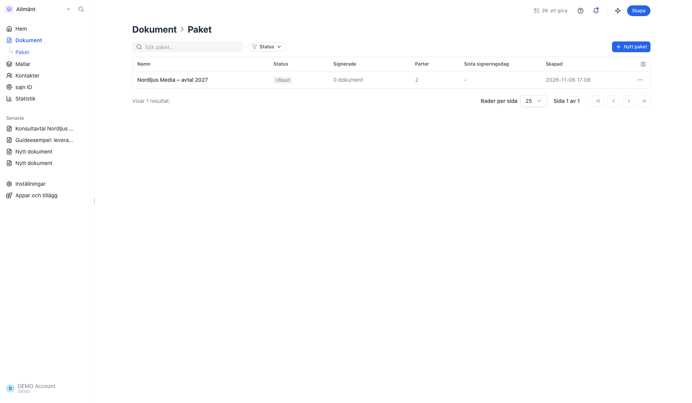
    </Frame>

    Du kan också börja från utkast du redan har. Markera dem i dokumentlistan, öppna **Åtgärder** och välj **Skapa paket**. Laddar du upp flera filer på en gång via **Skapa** kan du välja **Separata dokument i ett paket**.
  </Step>

  <Step title="Lägg till dokumenten">
    Klicka på **Lägg till dokument** och välj hur dokumentet ska in i paketet:

    - **Ladda upp eller skapa nytt** öppnar dialogen **Lägg till dokument**. Ladda upp filer, börja från en mall eller skapa ett tomt dokument.
    - **Välj befintliga utkast** listar utkast som inte redan ligger i ett paket. Bocka i dem och klicka på **Lägg till dokument**.

    <Frame>
      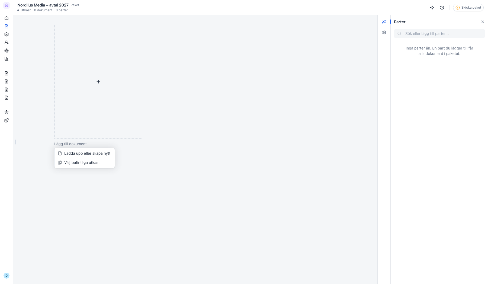
    </Frame>

    <Frame>
      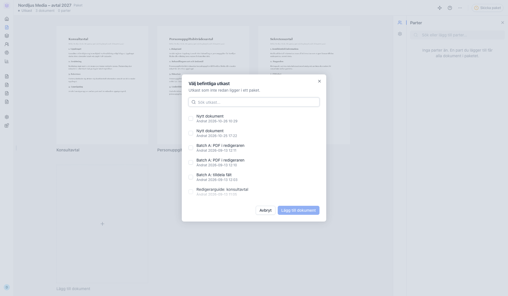
    </Frame>

    Varje dokument visas som en sida i paketet. För muspekaren över sidan och klicka på krysset för att ta bort dokumentet ur paketet. Dokumentet finns kvar som utkast.
  </Step>

  <Step title="Lägg till parterna">
    Under **Parter** till höger klickar du på **Sök eller lägg till parter...**. Sök fram en kontakt eller fyll i namn och e-post. Signaturtyp, leveransmetod och verifiering väljer du här, och de gäller i alla dokument parten signerar.

    Alla parter i ett paket behöver en e-postadress, eftersom inbjudan skickas en gång per adress.

    <Frame>
      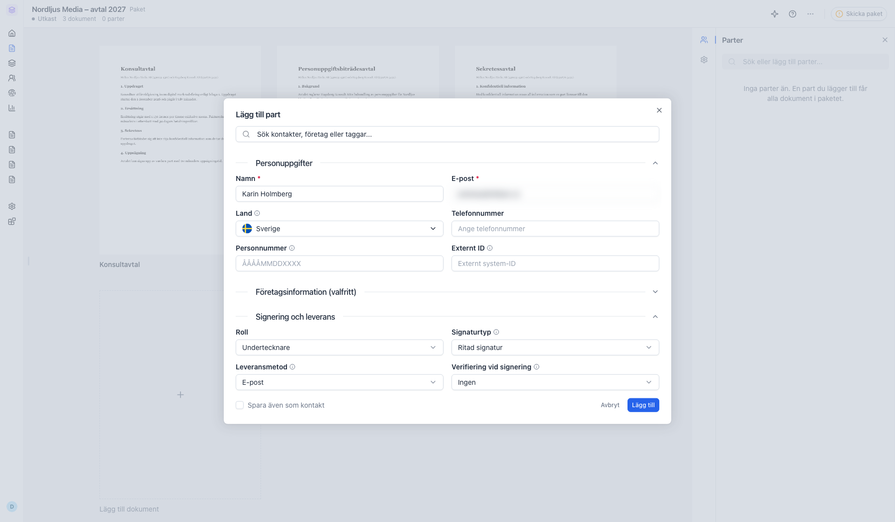
    </Frame>

    Vill du ändra eller ta bort en part öppnar du menyn med tre punkter på partens kort. Tar du bort en part som har signaturrutor eller fält i ett dokument visar sajn först vad som ändras.
  </Step>

  <Step title="Välj vilka dokument varje part signerar">
    En ny part får alla dokument i paketet. Under partens namn står till exempel **3 av 3 dokument**. Klicka på texten och bocka ur de dokument som parten inte ska signera.

    I exemplet signerar Erik Lund konsultavtalet och personuppgiftsbiträdesavtalet, men inte sekretessavtalet.

    <Frame>
      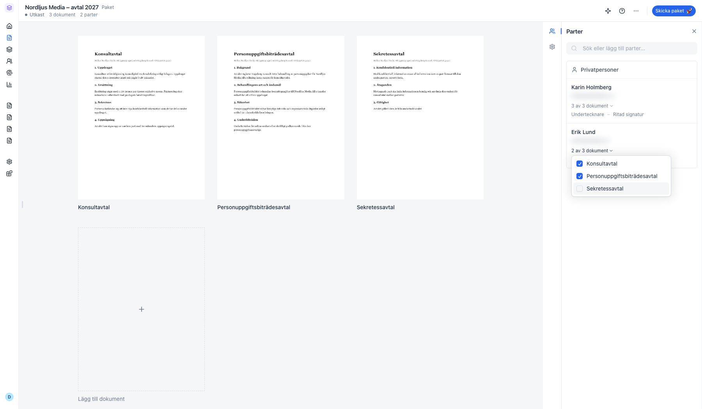
    </Frame>
  </Step>

  <Step title="Ställ in paketet">
    Klicka på kugghjulet till höger för att öppna **Inställningar**. Det du väljer här gäller alla dokument i paketet:

    - **Utgångsdatum**: sista dagen att signera.
    - **Påminnelser**: hur ofta parter som inte har signerat får en påminnelse.
    - **Ordning**: **Alla samtidigt** eller **I turordning**. I turordning signerar parterna i den ordning de står under **Parter**. Ändra ordningen med **Flytta upp** och **Flytta ned** i partens meny.
    - **Föredraget språk**: språket i mejlen, på signeringssidan och i signeringsintygen.

    Under **Utskick** skriver du meddelandet i inbjudan. Där väljer du också vilka som ska få en kopia av de färdiga dokumenten. **Signering** och **Internt** har resten av inställningarna, till exempel synlighet i arbetsytan.

    Ska parterna verifiera sig innan de ser dokumenten väljer du en metod under **Signering** > **Verifiering för att öppna**. Parten verifierar sig en gång, och sedan öppnas alla dokument i paketet.

    <Frame>
      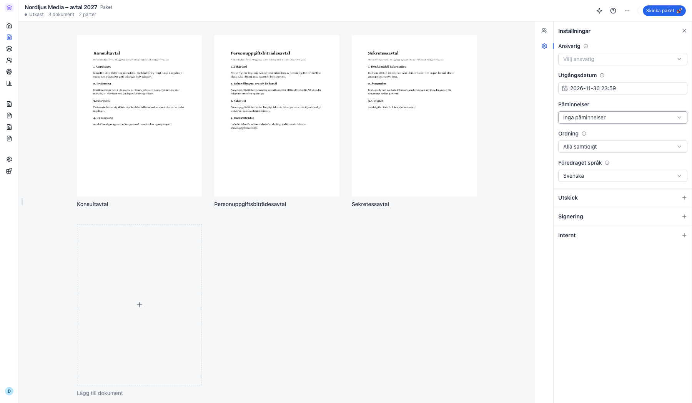
    </Frame>
  </Step>

  <Step title="Redigera innehållet i dokumenten">
    Klicka på en sida i paketet för att öppna dokumentet i redigeraren. Där ändrar du text, fält och bilagor som vanligt.

    Parterna och utskicket styrs av paketet. I dokumentets panel **Parter** står **Parterna ställs in i paketet**, och **Redigera i paketet** tar dig tillbaka. Paketets namn står under dokumentets titel. Så länge dokumentet är ett utkast finns knappen **Gå till paketet** där du annars skickar dokumentet.

    <Frame>
      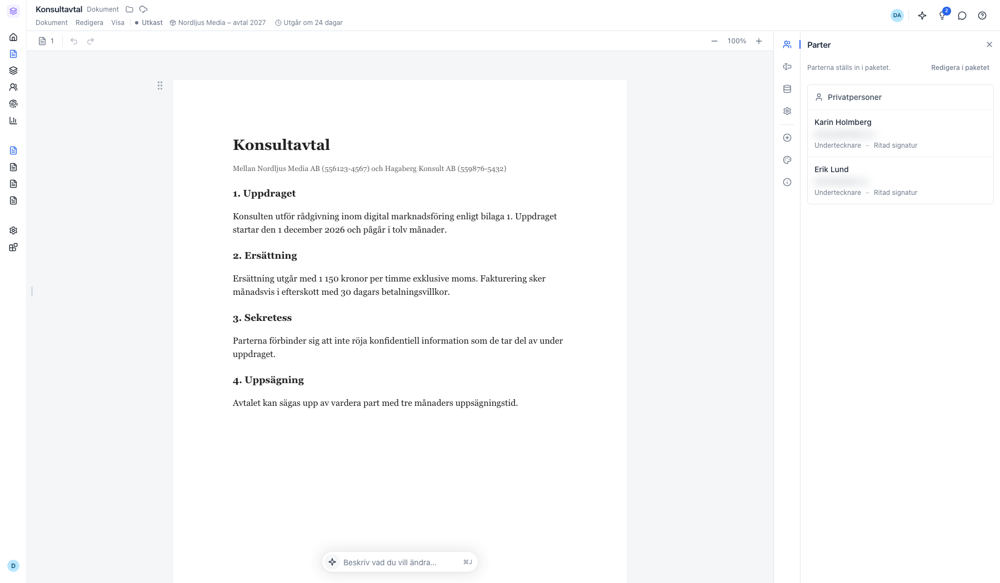
    </Frame>
  </Step>

  <Step title="Använd samma fält i flera dokument">
    Ska parten fylla i samma uppgift i flera dokument, till exempel organisationsnummer, lägger du in samma fält i dem. Då fyller parten i uppgiften en gång.

    Öppna dokumentet och panelen **Fält**. Under **Fält från paketets andra dokument** står fälten som parterna fyller i i paketets andra dokument. Dra ett fält till PDF:en. Vill du ha fältet på flera ställen i samma dokument drar du det från listan över dokumentets egna fält.

    <Frame>
      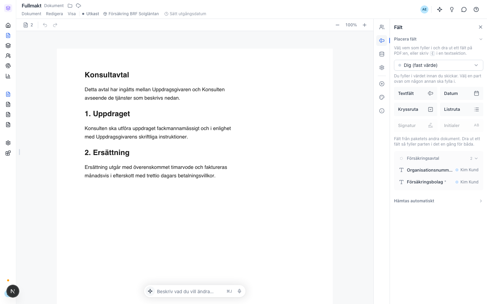
    </Frame>

    Klicka på fältet och välj **Redigera** för att se hur ofta det används, till exempel **Används 3 gånger i 2 dokument**. Ändrar du alternativ eller format på ett av fälten ändras alla.

    <Frame>
      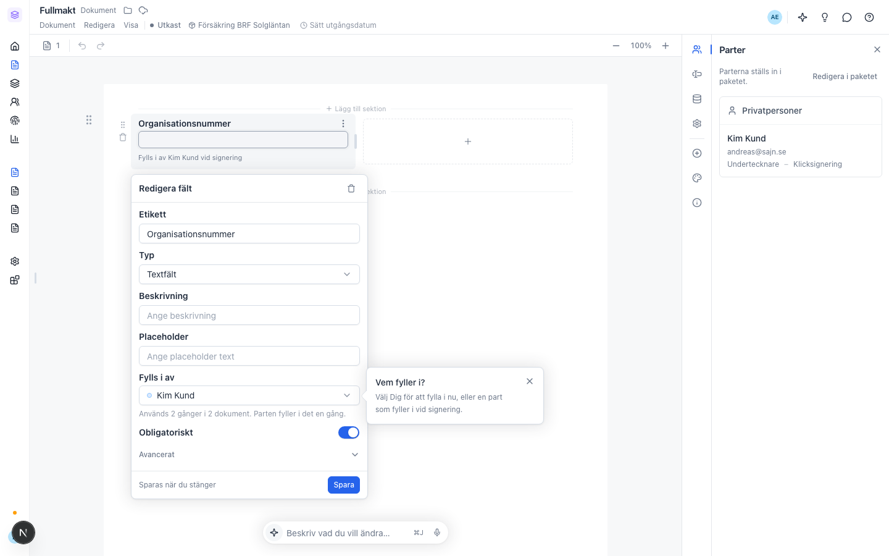
    </Frame>

    Ett nytt fält är alltid ett eget fält, även om det heter samma sak som ett fält i ett annat dokument. Två fält blir samma fält bara när du drar in fältet från listan, eller när de har samma nyckel, samma part, samma typ och samma inställningar. Nyckeln ser du under **Avancerat** i fältets inställningar.
  </Step>

  <Step title="Kontrollera och skicka">
    Saknas något visar knappen **Skicka paket** en varningssymbol. Klicka på den för att se vad som är kvar. Varje rad säger vilket dokument som behöver ändras.

    <Frame>
      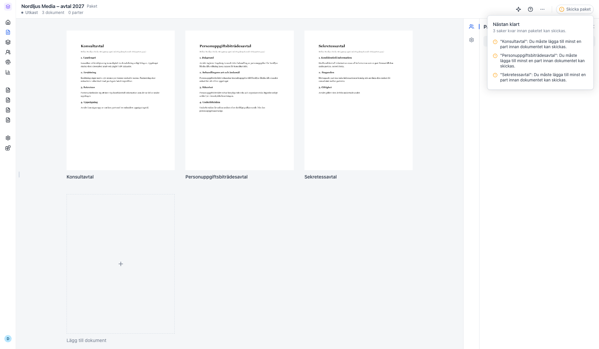
    </Frame>

    När allt är klart klickar du på **Skicka paket** och bekräftar. Finns det bara saker att se över, till exempel att någon får dokumentet senare i turordningen, kan du välja **Skicka ändå**.

    <Frame>
      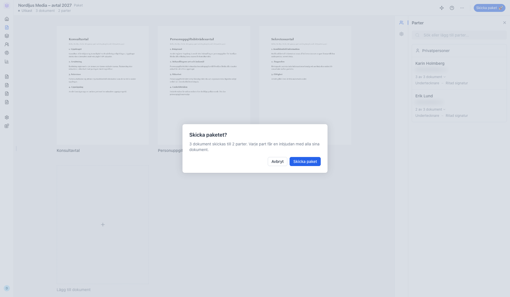
    </Frame>
  </Step>
</Steps>

## Följ ett skickat paket

Ett skickat paket har status **Öppet** tills alla dokument är signerade. Då blir det **Klart**.

Under **Parter** står hur många dokument varje part har kvar, eller **Klar**. Under varje sida i paketet ser du dokumentets status och vilka som ska signera det.

<Frame>
  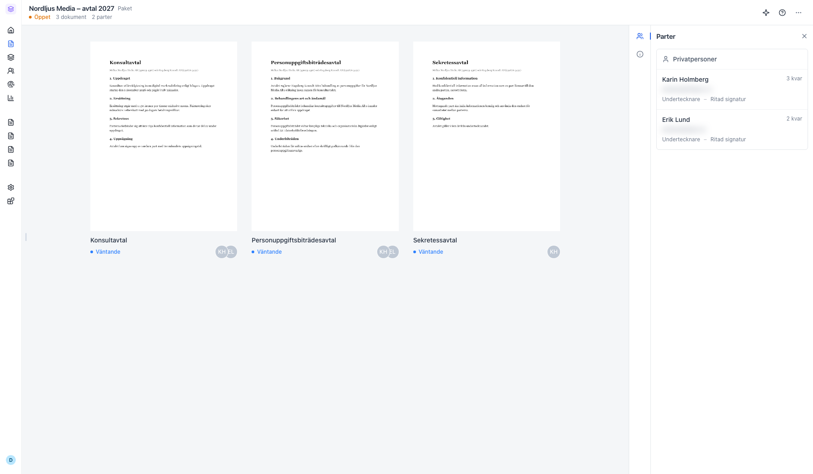
</Frame>

Klicka på informationsikonen till höger för att öppna **Detaljer**. Där ser du hur många dokument som är signerade, hur många parter som är klara, sista signeringsdag och vem som skapade paketet.

Längst ner i **Detaljer** listar **Aktivitet** paketets historik: när det skapades, skickades och återkallades, när en part öppnade paketet eller signerade sina dokument, och när paketet blev färdigsignerat. Där står också när en part öppnade, signerade eller avvisade ett enskilt dokument. Du behöver behörighet att läsa dokumentens logg för att se listan.

<Frame>
  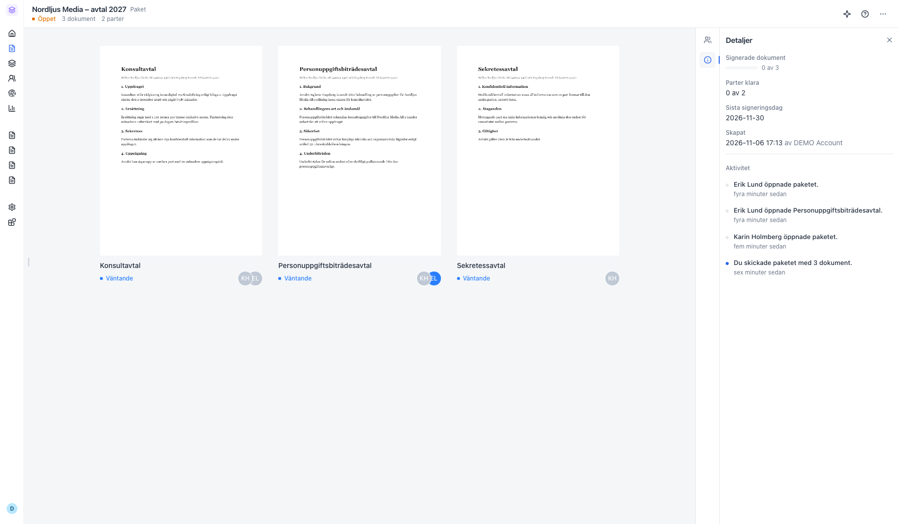
</Frame>

[Paket](https://app.sajn.se/~/documents/packages) listar alla paket med status, hur många dokument som är signerade, antal parter och sista signeringsdag.

<Frame>
  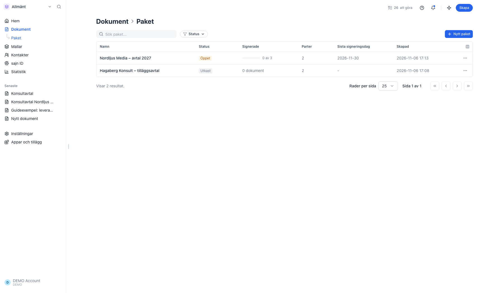
</Frame>

### Hjälp en part som inte har signerat

Öppna menyn med tre punkter på partens kort under **Parter**:

- **Kopiera signeringslänk** kopierar länken till partens paket. Länken öppnar alla dokument som parten ska signera.
- **Skicka inbjudan igen** skickar samma inbjudan en gång till.
- **Ändra kontaktuppgifter** rättar partens e-post eller mobilnummer. Klicka på **Spara och skicka igen**. Parten får en ny inbjudan till alla sina dokument. Byter du e-post slutar den gamla länken att fungera.

<Frame>
  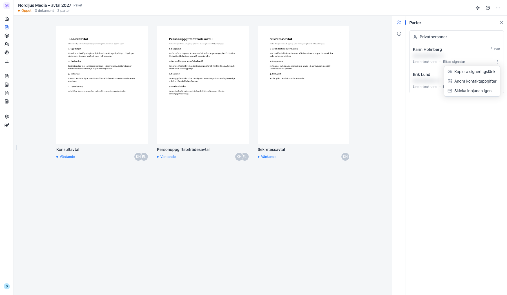
</Frame>

<Frame>
  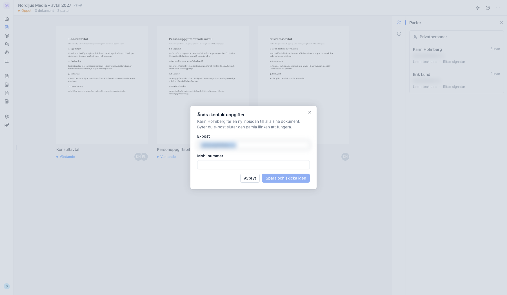
</Frame>

Kontaktuppgifterna är det enda du kan ändra i ett skickat paket. Allt annat ändrar du genom att återkalla paketet.

## Återkalla ett paket

Det finns två sätt att återkalla ett paket. De gör olika saker.

**Från paketet.** Öppna paketet, klicka på menyn med tre punkter överst och välj **Återkalla paketet**. Alla dokument blir utkast igen och alla signaturer tas bort. Paketet blir ett utkast med samma dokument, parter och inställningar. Ändra det du behöver och skicka igen. Då signerar alla på nytt. Parterna får ett mejl och deras länkar slutar fungera. Har ett dokument redan blivit färdigsignerat går paketet inte att återkalla på det här sättet.

<Frame>
  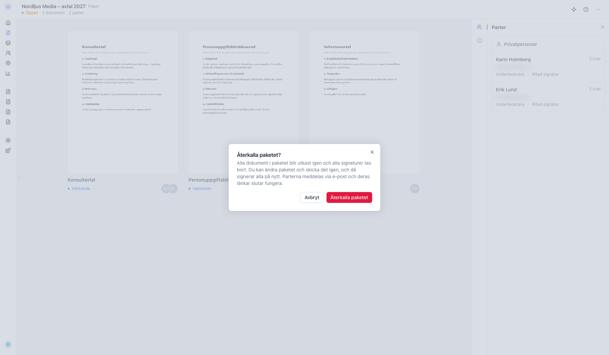
</Frame>

**Från listan.** Under [Paket](https://app.sajn.se/~/documents/packages) öppnar du menyn med tre punkter på paketets rad och väljer **Återkalla paketet**. Dokument som inte är färdigsignerade blir utkast igen och parterna får ett mejl. Färdigsignerade dokument påverkas inte. Paketets länkar slutar fungera och paketet får status **Återkallat**. Använd det här sättet när du vill avsluta paketet och inte skicka det igen.

## Så signerar parten

Inbjudan säger hur många dokument parten ska signera och listar dem. Knappen **Öppna dokumenten** leder till paketets sida i sajn.

Sidan visar ett kort per dokument, med antal sidor och status. **Att läsa** betyder att parten inte har öppnat dokumentet än. Längst ner står hur många dokument som är kvar att läsa.

<Frame>
  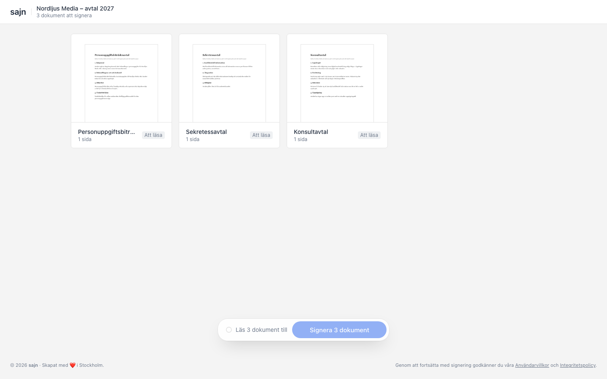
</Frame>

1. Parten klickar på ett kort och läser dokumentet. När ett dokument är läst får kortet en bock.
2. När alla dokument är lästa går knappen **Signera 3 dokument** att klicka på. Siffran är antalet dokument parten signerar.
3. Parten signerar alla dokument på en gång. Med BankID godkänner parten en gång i BankID-appen. Med ritad signatur ritar parten en gång, och samma signatur hamnar i alla dokument. Med klicksignering räcker ett klick på **Signera**.

Kräver paketet verifiering visar sidan verifieringen innan korten. Parten verifierar sig en gång för alla dokument.

Har parten fält att fylla i ett dokument står det **Signeras i dokumentet** på kortet. Parten öppnar dokumentet, fyller i fälten och signerar det där. De andra dokumenten signeras tillsammans som vanligt.

Finns samma fält i flera dokument fyller parten i det en gång. När parten öppnar nästa dokument står svaret redan där. Parten kan ändra det före signeringen. Ett dokument som parten ska signera senare i turordningen står som **Väntar på din tur**.

Menyn med tre punkter överst på sidan har fyra val:

- **Avvisa alla** avvisar alla dokument som väntar på partens signatur. Parten kan skriva en anledning, och du får ett meddelande.
- **Ladda ner alla** laddar ner dokumenten.
- **Språk** byter språk på sidan.
- **Kontakta support** öppnar ett mejl till sajns support. Har avsändaren egen profilering står **Kontakta avsändaren** i stället.

<Frame>
  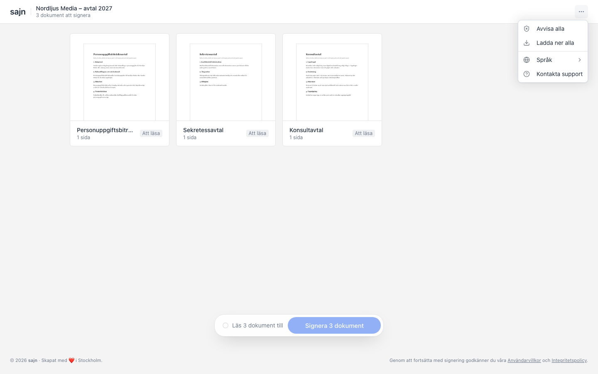
</Frame>

## Mejl efter signeringen

Paketet mejlar varje part en gång för alla dokument, inte en gång per dokument:

- När parten har signerat alla sina dokument får parten en bekräftelse.
- När alla dokument i paketet är signerade får varje part ett mejl med alla färdiga dokument som bilagor. Blir bilagorna för stora innehåller mejlet en länk till paketet i stället.
- De som ska få en kopia under **Utskick** får alla färdiga dokument i ett mejl när paketet är klart.

Avvisas ett dokument eller går det ut kan paketet inte bli klart. Då får parterna och kopiemottagarna ett mejl per färdigsignerat dokument i stället.

Du som är ansvarig för paketet får fortfarande ett mejl per dokument.

## När dokumenten inte går att skicka som paket

Ett paket signeras med en underskrift per part. Därför går det inte att skicka dokument där en part måste signera separat:

- Dokumentet innehåller en betalning.
- Dokumentet har signatur- eller initialrutor.
- Parten ska signera med en annan e-legitimation än svenskt BankID.
- Parten ska ange en PIN-kod innan signering.

Det här stoppar också ett paket:

- Paketet har färre än 2 eller fler än 50 dokument.
- Ett dokument är inte ett utkast, eller ligger redan i ett annat paket.
- Ett dokument saknar något som krävs för att skicka det, till exempel en part.
- En part saknar e-postadress.
- Dokumenten kräver godkännande innan utskick.

Knappen **Skicka paket** visar vilket dokument som stoppar utskicket och varför.

## Skicka paket via API:et

Paket går också att skapa och skicka via API:et, från API-version 2026-10. Samma kontroller gäller där.

## Nästa steg

<CardGroup cols={2}>
  <Card title="Skicka för signering" icon="paper-plane" href="/guider/skicka-dokument">
    Skicka ett enskilt dokument till parterna.
  </Card>
  <Card title="Massutskick" icon="paper-plane" href="/guider/massutskick">
    Skicka samma mall till många mottagare, ett dokument per person.
  </Card>
  <Card title="Signeringsordning" icon="list-ol" href="/guider/sekventiell-signering">
    Låt parterna signera i en bestämd ordning.
  </Card>
  <Card title="Så signerar mottagaren" icon="signature" href="/guider/signeringsupplevelsen">
    Signeringen för ett enskilt dokument, steg för steg.
  </Card>
</CardGroup>
