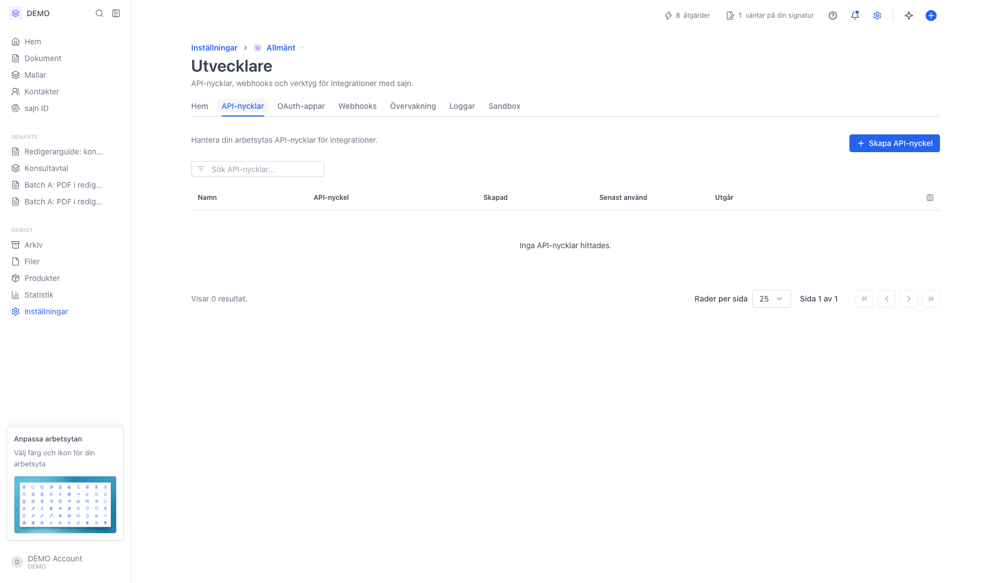

På sidan [Utvecklare](https://app.sajn.se/~/settings/organization/developer) hanterar du det som behövs för att bygga mot sajns REST API: API-nycklar, tjänstekonton och API-version. Loggar, webhooks och statistik finns i [Konsol](/guider/konsol), utvecklarverktyget längst ned på sidan. Den här guiden går igenom flikarna. Skapa bara en API-nyckel när du behöver en, eftersom nyckeln fungerar som riktiga inloggningsuppgifter.

Sidan ligger under organisationens inställningar. En API-nyckel tillhör **organisationen**, inte den som skapade den, och kan nå en eller flera arbetsytor.

## Innan du börjar

- För API-nycklar: du är administratör i alla arbetsytor som nyckeln ska nå, eller äger organisationen.
- API-åtkomst ingår i Team och Enterprise.

## Steg för steg

<Steps>
  <Step title="Öppna Inställningar och sedan Utvecklare">
    Fliken **Översikt** samlar det du behöver för att komma igång: rutan **Konsol**, genvägar till dokumentationen, MCP-servern och sajns Postman-samling, adressen till MCP-servern, och **API-gränser**. Gränsen – förfrågningar per minut – räknas per organisation, och `X-RateLimit-*`-headrarna i svaren visar aktuell status. Det finns ingen gräns per dygn.

    Klicka **Slå på utvecklarläge** i rutan **Konsol** för att få Konsol längst ned på varje sida.

    {/* TODO screenshot: fliken Översikt under Utvecklare med rutan Konsol, API-gränser och utvecklarresurser */}
  </Step>
  <Step title="Fliken API-nycklar listar organisationens nycklar">
    Tabellen på fliken [API-nycklar](https://app.sajn.se/~/settings/organization/developer/api-keys) visar **Namn**, nyckelns **Behörigheter**, en maskad **API-nyckel** (klicka på den för att avslöja prefixet), när nyckeln **skapades**, när den **senast användes** och när den **utgår**. Sökfältet uppe till vänster filtrerar på namn.

    <Frame>
      
    </Frame>
  </Step>
  <Step title="Skapa API-nyckel">
    Klicka på **Skapa API-nyckel**. På sidan som öppnas väljer du:

    - **Namn** – vad nyckeln används till, till exempel *Fortnox-integration*. Namnet syns i nyckellistan och i aktivitetsloggen.
    - **Arbetsytor** – de arbetsytor nyckeln får nå. Väljer du flera anger du också en **Standardarbetsyta**, som anrop utan headern `Sajn-Workspace` går till.
    - **Behörigheter** – *Alla*, *Endast läsning* eller *Anpassade*. Nyckeln har samma behörigheter i varje vald arbetsyta.
    - **Utgår** – *30 dagar*, *90 dagar*, *1 år* eller *Aldrig*.

    Nyckeln fortsätter att fungera om den som skapade den byter roll eller lämnar organisationen. Före utgångsdatumet får den som skapade nyckeln och administratörerna i standardarbetsytan ett mejl, 14 dagar före och dagen före.

    När nyckeln skapas visas hela värdet **bara en gång**. Kopiera den direkt och spara den säkert – du kommer inte att kunna se den igen.
  </Step>
  <Step title="Menyn på varje rad – regenerera eller återkalla">
    Menyn längst till höger på en nyckelrad låter dig:

    - **Redigera** – ändrar nyckelns namn, arbetsytor och behörigheter.
    - **Regenerera** – byter ut nyckelns hemliga värde mot ett nytt, som visas en gång, och du väljer när det nya värdet utgår. Det gamla värdet slutar fungera direkt, så uppdatera dina integrationer. Ett utgångsdatum kan inte förlängas – du förnyar en nyckel genom att regenerera den.
    - **Återkalla** – tar bort nyckeln helt. Alla anrop med den avvisas omedelbart.

    Längst ned i menyn står vem som skapade nyckeln, så att du kan stämma av internt innan du gör något destruktivt.
  </Step>
  <Step title="Konsol visar anropen och leveranserna">
    API-anrop, händelser, webhook-leveranser och statistik finns i Konsol. Där ser du varje anrop med nyckeln medan du bygger, och felen grupperade efter felkod. Loggarna sparas i **7 dagar** och är det första stället att titta när en integration inte beter sig som väntat. Se [Felsök integrationer i Konsol](/guider/konsol).
  </Step>
</Steps>

## Välj API-version

sajn ändrar ibland formatet på det som API:t och webhooks skickar. Varje sådan ändring får en ny **API-version**, namngiven efter månaden den släpptes, till exempel `2026-10`. Organisationens API-version bestämmer vilket format dina integrationer får, så att en ändring hos sajn inte bryter dem utan förvarning.

Inställningen gäller hela organisationen, inte bara arbetsytan. Rutan **API-version** visas på fliken **Översikt** om din roll har behörigheten **Hantera organisationsinställningar**.

1. Öppna [Inställningar → Utvecklare](https://app.sajn.se/~/settings/organization/developer) och leta upp rutan **API-version**.
2. Välj en version i menyn. Den nyaste är märkt **Senaste**. En utfasad version är märkt **Utfasas** med datumet då den slutar fungera.
3. Klicka **Byt version** för att bekräfta.

{/* TODO screenshot: rutan API-version på fliken Översikt under Utvecklare, med menyn öppen och tabellen Anrop de senaste 72 timmarna */}

Bytet påverkar så här:

- Anrop som inte anger någon version, och webhooks som skapas efter bytet, använder den nya versionen direkt.
- Befintliga webhooks behåller sin egen version. Du byter version på en webhook i dess dialog, se [Konfigurera webhooks](/guider/webhooks).
- Integrationer som själva anger version i sina anrop påverkas inte.
- OAuth-appar påverkas inte. En app har en egen API-version, som sätts när appen skapas, och använder den för anrop utan version.

Är organisationens version utfasad visar rutan datumet då den slutar fungera. Byt version före det datumet, tillsammans med den som byggt dina integrationer. Har ingen version valts än visar menyn **Inte vald**, och den senaste versionen väljs vid organisationens första anrop med en API-nyckel.

Tabellen **Anrop de senaste 72 timmarna** visar vilka versioner dina integrationer faktiskt använder: version, hur den valdes (**Header** betyder att integrationen angav versionen själv, **Organisationens standard** att anropet saknade header. Anrop från en OAuth-app utan header visas också som **Organisationens standard**, med appens version), antal anrop och när versionen senast användes. Titta här innan du byter, så ser du om någon integration fortfarande använder en äldre version.

Utvecklare hittar detaljerna i [Versionshantering](/api-reference/versioning).

## De andra flikarna

- **Tjänstekonton** – konton som äger API-nycklar för integrationer, så att en nyckel inte är knuten till en person.
- **OAuth-appar** – egna OAuth-klienter, för den som bygger en app som andra sajn-organisationer ska kunna ansluta.
- **Sandbox** – en separat testmiljö kopplad till organisationen, så att du kan bygga utan att röra skarpa dokument.

Två flikar dyker bara upp när funktionen är påslagen för organisationen: **sajn Login** och **Inbäddning**.

<Warning>
  En API-nyckel ger åtkomst till arbetsytans data. Lägg den aldrig i klientkod, i ett publikt repo eller i en skärmdump. Misstänker du att en nyckel läckt – återkalla den direkt.
</Warning>

## Nästa steg

<CardGroup cols={2}>
  <Card title="Konfigurera webhooks" icon="webhook" href="/guider/webhooks">
    Ta emot händelser i ditt eget system när dokument signeras eller slutförs.
  </Card>
  <Card title="Automatisera med Zapier och Make" icon="bolt" href="/guider/zapier-och-make">
    Koppla ihop sajn med andra tjänster utan att skriva kod.
  </Card>
</CardGroup>
