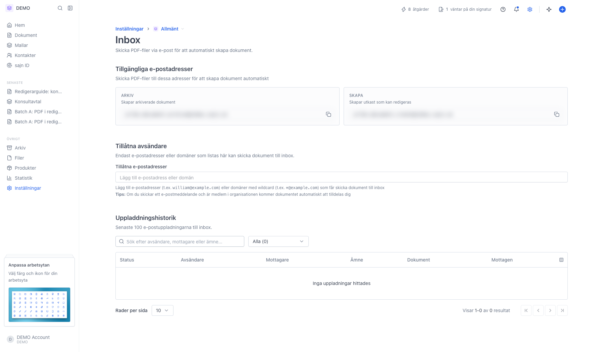

Med inbox mejlar du och dina kollegor in PDF-filer till sajn, och dokumenten skapas automatiskt – antingen som arkiverade dokument eller som redigerbara utkast. På sidan [Inställningar → Inbox](https://app.sajn.se/~/settings/workspace/inbox) ser du arbetsytans två adresser, vilka avsändare som släpps igenom och vad som hände med varje mejl.

## Innan du börjar

- Du är inloggad och har behörighet att hantera arbetsytans inställningar.
- Inbox kräver Solo eller högre.
- Adresserna är unika per arbetsyta. Listan över tillåtna avsändare gäller däremot hela organisationen – den delas mellan alla arbetsytor.

## Steg för steg

<Steps>
  <Step title="Öppna Inställningar och sedan Inbox">
    Sidan är uppdelad i tre avsnitt ovanifrån och ned: **Tillgängliga e-postadresser**, **Tillåtna avsändare** och **Uppladdningshistorik**.

    <Frame>
      
    </Frame>
  </Step>
  <Step title="Tillgängliga e-postadresser – arbetsytans två adresser">
    Arbetsytan har två färdiga adresser, båda byggda på arbetsytans namn:

    - **Arkiv** – `<arbetsyta>.document.archive@inbox.sajn.se`. Mejl hit skapar **arkiverade dokument** direkt, lämpligt för färdiga PDF:er som bara ska in i arkivet.
    - **Skapa** – `<arbetsyta>.document.create@inbox.sajn.se`. Mejl hit skapar **utkast som kan redigeras**, så att du eller en kollega kan komplettera dokumentet och skicka det för signering.

    Kopieringsikonen till höger om en adress lägger den i urklipp – behändigt när du ska lägga in den som vidarebefordringsregel i din mejlklient.

    Skicka PDF:en som **bilaga**. Ett mejl blir ett dokument: bifogar du flera PDF:er hamnar alla i samma dokument. Dokumentet får den första bilagans filnamn som titel; mejlets ämnesrad sparas bara i historiken.

    Till **Skapa**-adressen kan du också skriva i mejlet vad som ska förberedas, med vanliga ord:

    ```
    Titel: Konsultavtal Acme 2026
    Skicka till Anna Svensson anna@acme.se och Maria Ek. Anna signerar först.
    Johan Berg ska granska. Jag skriver också under.
    ```

    - **Titel** – skriver du en titel används den i stället för filnamnet.
    - **Parter** – bara personer som du uttryckligen ber om att lägga till blir parter. Personer i ett vidarebefordrat mejl, i kopia eller i en signatur läggs aldrig till.
    - **Kontaktuppgifter** – skriv e-postadress eller telefonnummer. Utan det hämtas uppgifterna från arbetsytans kontakter om exakt en kontakt har samma fullständiga namn.
    - **Ordning och roll** – anger du vem som signerar först numreras alla parter i den ordningen. Den som ska *granska* läggs till som granskare.
    - **Du själv** – skriv till exempel "jag skriver också under" så läggs du till som part. Det fungerar bara om du är medlem i arbetsytan.

    Dokumentet blir alltid ett utkast; inget skickas förrän du skickar det. Notisen om det nya dokumentet berättar vilka parter som lades till och vilka som inte kunde läggas till.

    <Note>
      Instruktionerna läses av AI och kräver att AI är påslaget för arbetsytan. Är AI avstängt skapas dokumentet som vanligt, utan titel eller parter från mejlet.
    </Note>
  </Step>
  <Step title="Tillåtna avsändare – styr vem som får mejla in">
    För att inte vem som helst ska kunna skapa dokument i arbetsytan måste avsändaren finnas i listan. Allt annat avvisas och syns som *Avböjd* i historiken.

    Du kan lägga till två slags poster:

    - En **enskild e-postadress**, t.ex. `william@dittforetag.se`.
    - En **hel domän med wildcard**, t.ex. `*@dittforetag.se`, för att släppa in alla anställda.

    Skriv värdet i fältet och tryck *Enter* för att lägga till det som en etikett. Klicka på krysset på en etikett för att ta bort den. Ändringen sparas direkt.

    <Tip>
      Är avsändaren medlem i arbetsytan tilldelas det inkomna dokumentet automatiskt till hen. Annars hamnar det hos organisationens ägare.
    </Tip>
  </Step>
  <Step title="Uppladdningshistorik – följ vad som hände med varje mejl">
    Tabellen visar de **senaste 100 e-postuppladdningarna** till arbetsytans inbox, med kolumnerna **Status**, **Avsändare**, **Mottagare** (vilken av de två adresserna mejlet gick till), **Ämne**, **Dokument** och **Mottagen**.

    Statusen berättar vad som hände:

    - **Bearbetad** – PDF:en kom igenom och ett dokument skapades. Klicka på namnet i kolumnen *Dokument* för att hoppa dit.
    - **Väntar** – mejlet är mottaget men bearbetas fortfarande.
    - **Avböjd** – avsändaren saknas i listan *Tillåtna avsändare*. Lägg till avsändaren om det var legitimt.
    - **Misslyckad** – något gick fel vid bearbetningen, t.ex. en trasig eller lösenordsskyddad PDF.

    Sök på avsändare, mottagare eller ämne i fältet uppe till vänster, eller filtrera på status i menyn bredvid. Det är härifrån du felsöker när någon säger *"jag mejlade in en PDF men det dök inte upp något dokument"*.
  </Step>
</Steps>

## Nästa steg

<CardGroup cols={2}>
  <Card title="Ladda upp en PDF direkt" icon="file-pdf" href="/guider/create-document-from-pdf">
    Vanligaste vägen in när du redan sitter i sajn.
  </Card>
  <Card title="Arkivet" icon="box-archive" href="/guider/arkivet">
    Dit arkiv-adressens dokument hamnar.
  </Card>
</CardGroup>
