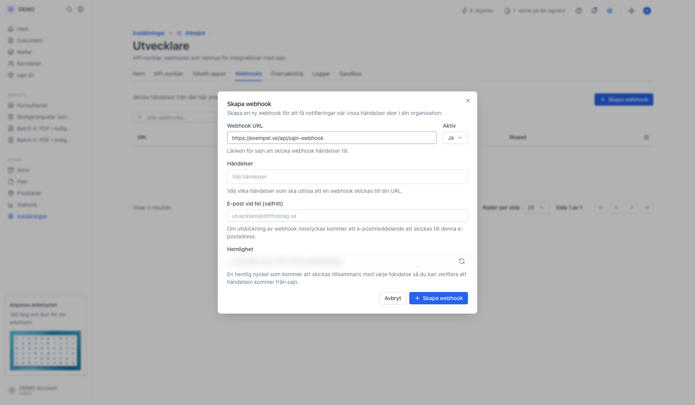
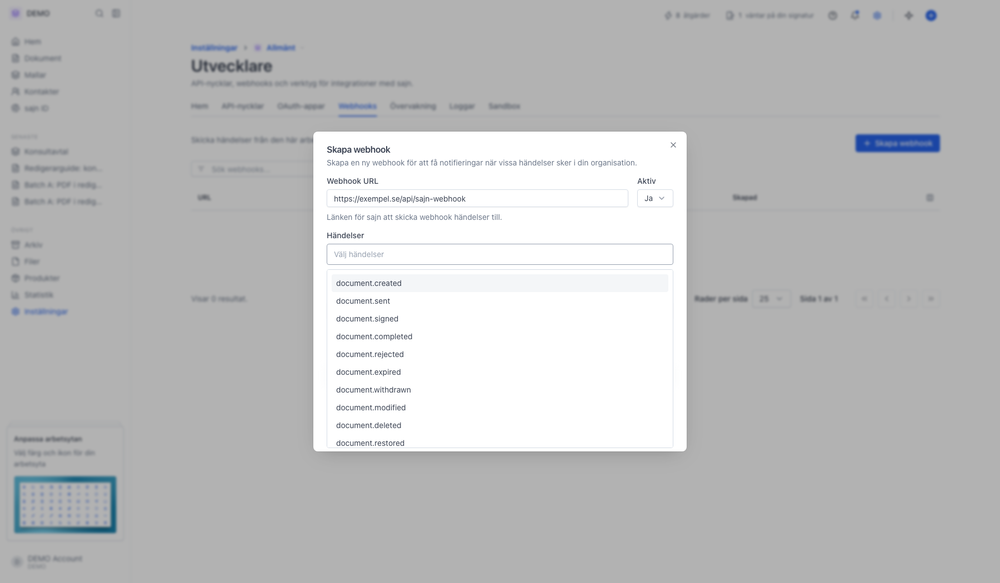

En **webhook** är ett automatiskt meddelande som sajn skickar till ett annat system när något händer, till exempel när ett avtal är signerat. Det andra systemet kan då agera direkt: uppdatera affären i ditt CRM, skapa en faktura eller spara det signerade dokumentet, utan att någon behöver flytta uppgifterna för hand.

Någon behöver bygga mottagaren, oftast en utvecklare. Har du ingen utvecklare kan du koppla ihop sajn med andra tjänster i [Zapier eller Make](/guider/zapier-och-make) i stället.

Tekniskt får din integration ett HTTP-anrop i realtid när någon signerar, avböjer eller när hela dokumentet är klart. Den här guiden visar var webhooks ligger, vad dialogen innehåller och vilka händelser du kan prenumerera på.

Webhooks hanterar du i [Konsol](/guider/konsol), utvecklarverktyget längst ned på sidan. Konsol visas när du har slagit på utvecklarläge.

Webhooks hör till **arbetsytan** du står i. Vill du ha samma händelser från flera arbetsytor behöver du en webhook per arbetsyta.

## Innan du börjar

- Du är inloggad och har behörighet att hantera webhooks i arbetsytan.
- API-åtkomst ingår i Team och Enterprise.
- Din mottagande endpoint går att nå över HTTPS från publika internet. Adresser som pekar inåt i ett privat nät avvisas.

## Steg

<Steps>
  <Step title="Öppna fliken Webhooks i Konsol">
    Öppna [fliken Webhooks i Konsol](https://app.sajn.se/~/settings/organization/developer/webhooks). Länken slår på utvecklarläge om det är avstängt. Tabellen visar varje **Endpoint** med API-version och arbetsyta, **Status**, **Leveranser 72 h**, **Felfrekvens**, **Svarstid p50** och **Senaste leverans**. Klicka på en rad för att se endpointens leveranser. Menyn längst till höger på varje rad har **Visa leveranser**, **Redigera** och **Ta bort**.

    {/* TODO screenshot: fliken Webhooks i Konsol med tabellen och knappen Skapa webhook */}
  </Step>
  <Step title="Skapa webhook">
    Klicka **Skapa webhook**. Fälten är:

    - **Webhook URL** – den HTTPS-endpoint sajn ska skicka JSON till, t.ex. `https://dittforetag.se/api/webhook`. URL:en valideras innan webhooken sparas.
    - **Aktiv** – välj **Nej** för att skapa webhooken inaktiverad.
    - **Arbetsytor** – visas bara för administratörer i organisationen. Välj arbetsytan du står i, eller **Alla arbetsytor** för händelser från hela organisationen, även arbetsytor som skapas senare. **Alla arbetsytor** kräver API-version `2026-10`; varje händelse anger sin arbetsyta i `workspaceId`.
    - **Händelser** – en eller flera händelser som ska utlösa anropet. Se nästa steg.
    - **API-version** – bestämmer formatet på händelserna som skickas till din URL. Förvald är organisationens API-version, som du väljer på [Utvecklare-sidans start](/guider/settings-developer-api). Webhooken behåller sin version tills du byter den här, även om organisationen byter version senare. En utfasad version visar datumet då den upphör.
    - **E-post vid automatisk paus (valfritt)** – får ett mejl när webhooken pausas automatiskt, inte vid varje leveransfel. Lämnar du fältet tomt får organisationens ägare mejlet, om ägaren har den aviseringen påslagen.
    - **Hemlighet** – nyckeln som signerar varje anrop. Uppdateringsikonen i fältet fyller i ett nytt slumpat värde. Lämnar du fältet tomt skapar sajn en hemlighet åt dig. På API-version `2026-10` sparar sajn hemligheten i formatet för Standard Webhooks: `whsec_` följt av värdet du angav, base64-kodat. Öppna webhooken med **Redigera** efter att du sparat och kopiera hemligheten därifrån.

    <Frame>
      
    </Frame>

    {/* TODO screenshot: dialogen Skapa webhook med fältet API-version öppet, där den senaste versionen är märkt Senaste och en utfasad version visar sitt slutdatum */}
  </Step>
  <Step title="Välj bland tillgängliga händelser">
    Listan visar händelserna med sajns interna namn i gemener, till exempel `document.signed`. Skriv i fältet för att filtrera listan.

    **Dokument** – `document.created`, `document.sent`, `document.signed`, `document.completed`, `document.rejected`, `document.expired`, `document.withdrawn`, `document.modified`, `document.deleted`, `document.restored`, `document.archived`, `document.unarchived`, `document.expiration.extended`, `document.expiring.soon`, `document.archive.uploaded`, `document.comment.created`.

    **Per part** – `document.party.sent`, `document.party.delivery.failed`, `document.party.opened`, `document.party.read`, `document.party.signed`, `document.party.rejected`, `document.party.delegated`, `document.party.auth.failed`, `document.party.added`, `document.party.removed`, `document.party.verified`, `document.party.updated`.

    **Påminnelser** – `document.reminder.automatic`, `document.reminder.manual`.

    **Godkännanden** – `approval.request.created`, `approval.request.approved`, `approval.request.rejected`, `approval.request.cancelled`.

    **ID-kontroll** – `id.created`, `id.sent`, `id.opened`, `id.verified`, `id.failed`, `id.canceled`.

    **Kontakter, företag och mallar** – `contact.created`, `contact.updated`, `contact.deleted`, `company.created`, `company.updated`, `company.deleted`, `template.created`, `template.updated`, `template.deleted`, `template.restored`, `form.submitted`.

    **Organisation** – `workspace.created`, `member.added`, `member.invited`, `member.invite.accepted`, `usage.limit.reached`, `login.completed`, `login.failed`.

    **Säkerhet** – `security.document.downloaded`, `security.documents.exported`, `security.signature.identity.accessed`, `security.workspace.member.removed`, `security.workspace.member.role.changed`, `security.workspace.role.updated`, `security.workspace.retention.updated`. De är tänkta att matas in i ett SIEM.

    På API-version `2026-10` har varje leverans en `type`, och för några händelser skiljer den sig från namnet i listan. Till exempel blir `document.signed` till `document.fully_signed`, `document.modified` till `document.updated`, `id.created` till `identity_check.created` och `security.workspace.member.removed` till `security.member_removed`. `document.archive.uploaded` skickas inte till `2026-10`, där `document.created` täcker samma dokument. Alla typer finns under [Händelser](/webhooks/events).

    Välj så få som möjligt – en endpoint som prenumererar på allt får snabbt hög trafik. För de flesta integrationer räcker `document.signed` och `document.completed`.

    <Frame>
      
    </Frame>
  </Step>
</Steps>

## Verifiera att anropet kommer från sajn

Vilka headers en leverans har beror på webhookens API-version.

På `2026-10` följer leveranserna [Standard Webhooks](https://www.standardwebhooks.com):

- `webhook-id` – händelsens `id`, samma som fältet `id` i bodyn. Det är detsamma i alla omförsök och omsändningar, så använd det för att inte göra samma arbete två gånger.
- `webhook-timestamp` – när anropet skickades, i Unix-sekunder. Avvisa anrop som är äldre än din tolerans.
- `webhook-signature` – `v1,<base64>`, en HMAC-SHA256 över strängen `<webhook-id>.<webhook-timestamp>.<rå body>`. Nyckeln är hemligheten efter `whsec_`, base64-avkodad. Ett bibliotek för Standard Webhooks gör kontrollen åt dig, se [Verifiera signaturer](/webhooks/verify-signatures).

På `2026-09` har leveranserna de här headerna:

- `X-Sajn-Signature` – `t=<unix-sekunder>,v1=<hex>`, där `v1` är en HMAC-SHA256 över strängen `<t>.<rå body>` med din hemlighet som nyckel. Tidsstämpeln ingår i det signerade, så en tidigare leverans kan inte spelas upp igen. Avvisa anrop som är äldre än din tolerans.
- `X-Sajn-Delivery` – ett id för leveransen till just din endpoint. Det är detsamma i alla omförsök, men en omsändning får ett nytt. En `2026-09`-leverans har inget händelse-id, så gör din mottagare tålig mot att samma händelse kommer två gånger.
- `X-Sajn-Environment` – `production` eller `sandbox`.
- `X-Sajn-Secret` – hemligheten i klartext. Använd den inte, verifiera med `X-Sajn-Signature` i stället.

## Rotera hemligheten

Öppna webhooken via menyn på raden och välj **Redigera**, klicka på uppdateringsikonen i fältet **Hemlighet** och spara. Den nya hemligheten används direkt för alla efterföljande anrop – uppdatera din verifieringskod innan du sparar, annars faller inkommande anrop på valideringen.

Vill du byta utan avbrott på API-version `2026-10`, rotera i stället med [`POST /api/v1/webhooks/{id}/rotate-secret`](/webhooks/manage-endpoints#rotate-the-signing-secret). Då signeras leveranserna med både den gamla och den nya hemligheten i 24 timmar.

## När något inte kommer fram

Klicka på en endpoint på fliken **Webhooks** i Konsol för att se varje utskick med händelse, status och svarskod. Klicka på en leverans för att se anropet och svaret, och **Sänd om** för att skicka den igen. Loggarna sparas i 7 dagar.

Fliken **Händelser** visar allt som har hänt i arbetsytan, även händelser som ingen webhook lyssnar på, och leveranserna för varje händelse. Gäller felet ett visst dokument, öppna dokumentet och klicka **Inspektera**. Fliken **Tidslinje** visar då dokumentets händelser och leveranser i tidsordning. Mer om flikarna finns i [Felsök integrationer i Konsol](/guider/konsol).

Misslyckas en leverans gör sajn flera omförsök. Fortsätter leveranserna att misslyckas pausas webhooken till slut, se nästa avsnitt.

## Automatisk paus

En endpoint som fortsätter misslyckas pausas. Två villkor måste vara uppfyllda:

- Webhooken har **minst 5 misslyckade leveranser i rad**. En leverans räknas när dess omförsök är slut, inte per försök.
- Felserien har pågått i **72 timmar**. Svarskoden spelar ingen roll: en skur av fel pausar aldrig en endpoint, bara en serie som överlever hela fönstret.

En enda lyckad leverans nollställer serien. En endpoint som svarar `2xx` på vissa händelser och misslyckas med andra når därför aldrig gränsen, hur länge felen än fortsätter.

En pausad webhook får inga anrop alls förrän du återaktiverar den. Raden visar då statusen **Pausad** med orsak och tidpunkt, och du får en avisering i appen och ett mejl till adressen i **E-post vid automatisk paus**.

Öppna menyn på raden och välj **Återaktivera utan test** för att starta om webhooken direkt. Felräknarna nollställs. Vill du testa mottagaren först, klicka **Testa och återaktivera** på raden. sajn skickar då om den senaste misslyckade leveransen – de sparas i 7 dagar – och återaktiverar webhooken bara om testet går fram.

## Nästa steg

<CardGroup cols={2}>
  <Card title="Felsök integrationer i Konsol" icon="terminal" href="/guider/konsol">
    Leveranser, händelser och API-anrop live.
  </Card>
  <Card title="Aktivitetslogg" icon="scroll" href="/guider/settings-audit-log">
    Samma slags händelser, men för människor i stället för system.
  </Card>
</CardGroup>
